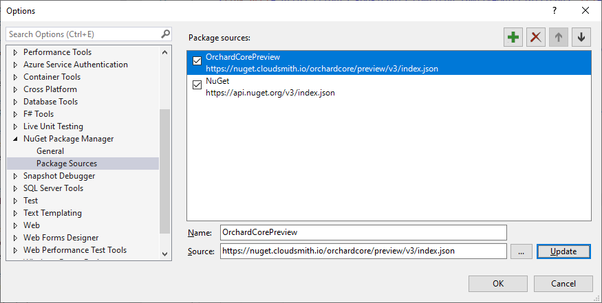

# Add preview package source

In this article, we are going to add a new package source pointing to the preview packages. When the `main` branch has changes, the daily preview build publishes packages to [Cloudsmith](https://cloudsmith.io/~orchardcore/repos/preview/packages/). The Preview - CI workflow can also be run manually. Release packages are published to NuGet, built from code corresponding to that release's version tag.

The preview packages are the most up-to-date versions but not the most stable and can contain breaking changes. Only use them if you want to work with the latest development version of Orchard Core, e.g. to try out a fix for a bug you reported.

!!! warning
    We do not suggest you use the preview packages in production. Preview packages are not kept forever, and there's no guarantee on how long a given preview package will be available. (You can assume something like 1-1.5 months, but then again, there's no guarantee.)

## Available preview feeds

Both feeds receive the same packages from each successful preview build. Choose either source; you do not need to configure both. Neither feed requires credentials to restore packages.

| Feed | NuGet v3 source URL |
| --- | --- |
| Cloudsmith | <https://nuget.cloudsmith.io/orchardcore/preview/v3/index.json> |

## Adding Orchard Core preview feed to Visual Studio

In order to be able to use the __preview__ feed from Visual Studio, open the Tools menu under NuGet Package Manager --> Package Manager Settings.
Use either NuGet v3 source URL from the table above.



## Adding Orchard Core preview feed with NuGet.config

You can also add the package source by using a NuGet.config file:

```xml
<?xml version="1.0" encoding="utf-8"?>
<configuration>
  <packageSources>
    <clear />
    <add key="NuGet" value="https://api.nuget.org/v3/index.json" />
    <add key="OrchardCorePreview" value="https://nuget.cloudsmith.io/orchardcore/preview/v3/index.json" />
  </packageSources>
  <disabledPackageSources />
</configuration>
```

## Adding Orchard Core preview feed with the .NET CLI

For example, to add the Cloudsmith feed:

```bash
dotnet nuget add source https://nuget.cloudsmith.io/orchardcore/preview/v3/index.json --name OrchardCorePreview
```
