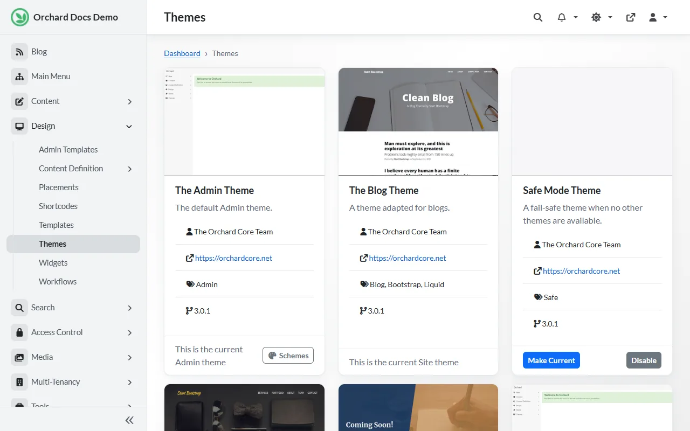

# Themes

A theme decides how pages look: the layout, colors, fonts, header, footer and where the menu and widgets go. Orchard Core uses two themes at once: the **site theme**, which visitors see on the public site, and the **admin theme**, which you see in the admin. Use the **Themes** screen to switch either one.

| | |
| --- | --- |
| **Menu** | **Design → Themes** |
| **Permission** | *Apply a Theme* |
| **Feature** | **Themes** (`OrchardCore.Themes`) |

## See the installed themes

Open **Design → Themes**. Each installed theme is a card with a preview picture, its name and description, the author, a website link, its tags and its version. The two current themes come first:

- The card of the current site theme says *This is the current Site theme*.
- The card of the current admin theme says *This is the current Admin theme*.

Every other card has a **Make Current** button and an **Enable** or **Disable** button.

A theme marked with the **Admin** tag is an admin theme. All other themes are site themes. You can't use an admin theme for the public site, or a site theme for the admin: **Make Current** always sets a theme in the place it is made for.

## Change the site theme

1. Open **Design → Themes**.
2. On the card of the theme you want, click **Make Current**.

The site confirms *... was set as the default Site theme*. If the theme was off, it is turned on first (*... was enabled*). Open the public site to see the result.

!!! warning
    A theme often comes with its own content types, templates and widget zones, and starter recipes create content made for one theme. After switching, check your home page, menus and widgets: some widgets may sit in a zone the new theme doesn't show. See [Widgets and layers](widgets-and-layers.md).

## Change the admin theme

1. Open **Design → Themes**.
2. On the card of an admin theme, click **Make Current**.

The site confirms *... was set as the default Admin theme*, and the admin uses it from the next page.

To keep the look the admin had before its color schemes, make **The Old Admin Theme** current. It shows the same screens with that look, and it has no schemes: its card has no **Schemes** button, and its **Toggle theme** menu only offers **Auto**, **Light** and **Dark**.

## Turn a theme on or off

**Enable** and **Disable** turn a theme on or off as a feature without making it current. A theme that is on can still add things to the site, such as templates or resources, even when it isn't current; most of the time you don't need to turn on a theme you don't use. You can't disable the current themes from this screen: their cards have no buttons.

## Reset the current themes

At the bottom of the page, the **Reset current themes** box has two buttons:

- **Reset Site Theme** clears the site theme choice. The public site then has no theme, so pages show without a theme's layout and styling. The **Blank site** and **Headless site** recipes start this way, for sites that don't use a public theme.
- **Reset Admin Theme** clears the admin theme choice. The admin then has no admin theme and is shown with the site theme, or without styling, which makes it hard to use.

Each asks you to confirm. Use them only for sites that don't use theming, or to recover from a theme that no longer works; pick a theme with **Make Current** afterwards.

## The built-in themes

| Theme | Kind | What it is for |
| --- | --- | --- |
| **The Admin Theme** (`TheAdmin`) | Admin | The default admin theme, the one this manual describes. |
| **The Old Admin Theme** (`TheOldAdmin`) | Admin | The look the admin had before its color schemes, for sites that need to keep it. It has no schemes. |
| **The Blog Theme** (`TheBlogTheme`) | Site | A blog: a header image, posts, categories and tags. Used by the **Blog** recipe. |
| **The Agency Theme** (`TheAgencyTheme`) | Site | A one-page agency or landing site with sections. Used by the **Agency** recipe. |
| **The Coming Soon Theme** (`TheComingSoonTheme`) | Site | A single "coming soon" landing page for a project under construction. Used by the **Coming Soon** recipe. |
| **The Default Theme** (`TheTheme`) | Site | A plain Bootstrap theme, a neutral starting point. Used by the **Software as a Service** recipe. |
| **Safe Mode Theme** (`SafeMode`) | Site | A very plain, fail-safe layout. Make it current when no other site theme works, to get a readable site back. |

The Blog, Agency and Default themes show the menu whose alias is `main-menu` (the **Main Menu** the **Blog** and **Agency** recipes create) in their navigation bar. See [Menus](menus.md). Each theme decides which zones it shows; the zones you set in **Settings → Zones** must match it. See [Widgets and layers](widgets-and-layers.md#choose-the-zones).

## Switch between light and dark

The admin theme has a theme switcher in the top bar (a half-filled circle icon, **Toggle theme**). Under **Mode** it offers **Auto**, **Light** and **Dark**; **Auto** follows your device's setting. The choice is kept in your browser. The Default Theme has the same switcher on the public site.

With The Admin Theme, under **Scheme**, the same menu lists the color schemes of the admin (see [Change the colors of the admin](#change-the-colors-of-the-admin)). The scheme in use is highlighted, and the site's default scheme is marked *(default)*. Pick one to see the admin in it at once; your choice is kept in your browser for this site. Pick the default scheme to follow the site's choice again, even when an administrator changes it later.

Whether the switcher appears in the admin, and other admin options such as the menu filter, quick navigation, breadcrumb and the List or Grid layout of admin lists, are set in **Settings → Admin**. See [General settings](../settings/general.md).

## Change the colors of the admin

The look of **The Admin Theme** comes from a **scheme**: four colors from which the admin works out every other color, for light and dark mode, and its fonts, text size, corners and spacing. The theme starts with seven schemes: Gray (the default), Blue, Ocean, Forest, Plum, Sunset and Graphite. Everyone sees the default scheme until they pick another one in **Toggle theme**.

The **Schemes** button is on the card of The Admin Theme in **Design → Themes**, while it is the current admin theme, for users who can apply a theme. The Old Admin Theme has no schemes.

### Add or edit a scheme

1. Open **Design → Themes**.
2. On the card of The Admin Theme, click **Schemes**. The **Admin schemes** list opens.
3. Click **Add scheme**, or **Edit** on the row of a scheme.
4. Type the **Name** users see in the scheme picker.
5. Pick the **Primary**, **Deep**, **Ink** and **Accent** colors, with the color picker or as a six-digit hex code, such as #2a81bb.
6. Optionally, check **Light menu** for a light gray menu with dark text in light mode.
7. Optionally, under **Typography and shape**, set the **Font**, **Heading font**, **Font size**, **Corners** and **Density**.
8. Optionally, under **Advanced**, fine tune what is worked out from the four colors: **Surface hue**, **Surface saturation**, **Text on primary**, **Page**, **List toolbar**, **Page tint**, **Dark page tint**, and the **Position** of the scheme in the pickers. Leave a setting empty to keep it automatic.
9. Check the **Preview**, which shows a small admin page in light and dark mode as you type.
10. Click **Save**.

The site confirms *The scheme ... was added* or *The scheme ... was saved*. Where a color would be too faint for the text on it, the admin deepens it, and the preview shows the result.

**Font** and **Heading font** suggest Lato, the font of the theme, and the system font. You can type another font name, or several separated by commas, but your users' devices must have that font installed.

### Set the default scheme

1. Open the **Admin schemes** list.
2. Open the actions of the scheme's row and click **Set as default**.

The site confirms *The scheme ... is now the default scheme*, and the list marks it **Default**. Users who haven't picked a scheme see it from their next page.

### Delete a scheme

1. Open the **Admin schemes** list.
2. Open the actions of the scheme's row and click **Delete**, then confirm.

Users who picked it go back to the site's default scheme. The default scheme can't be deleted, and its row has no actions menu: make another scheme the default first. A deleted scheme of the theme doesn't come back.

To copy the schemes to another site, add the **Admin schemes** step to a deployment plan. See [Import and export](../administration/import-and-export.md).

## Customize a theme's look

Apart from the schemes of the admin, themes don't have a settings screen for colors or fonts. To change how a page or part of a page looks without changing the theme's files, use [Templates](templates-and-placements.md). A new theme, or deeper changes, need a developer; see the Technical Manual.

## Video

This video changes the look of your site by choosing a theme.

<!-- video:themes-choose -->
<iframe width="560" height="315" src="https://www.youtube-nocookie.com/embed/gi1KWyaQ7mI" title="Themes: Change the Look of Your Site" frameborder="0" allow="accelerometer; autoplay; clipboard-write; encrypted-media; gyroscope; picture-in-picture" allowfullscreen></iframe>
